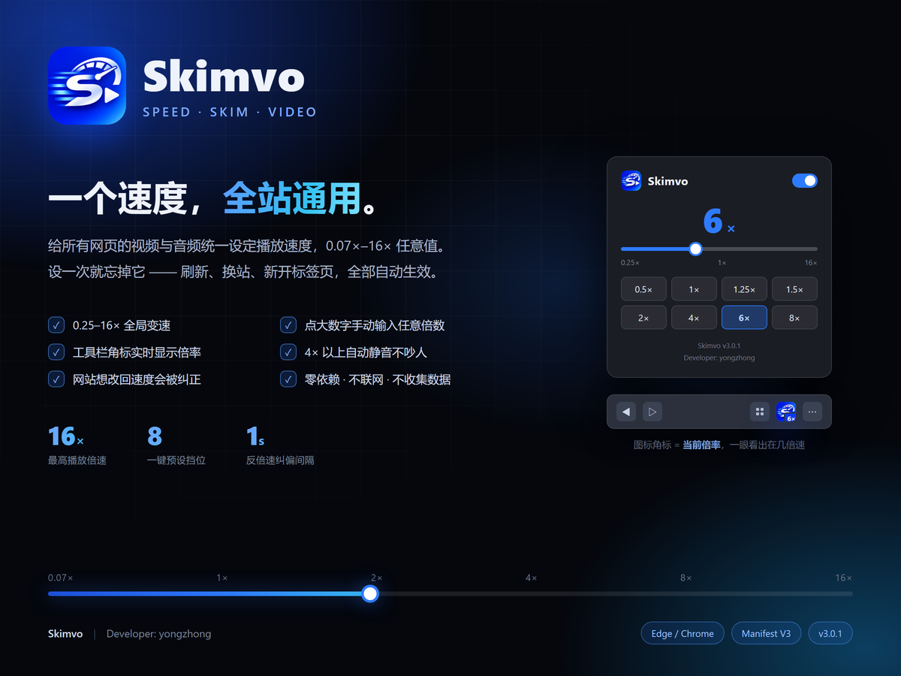
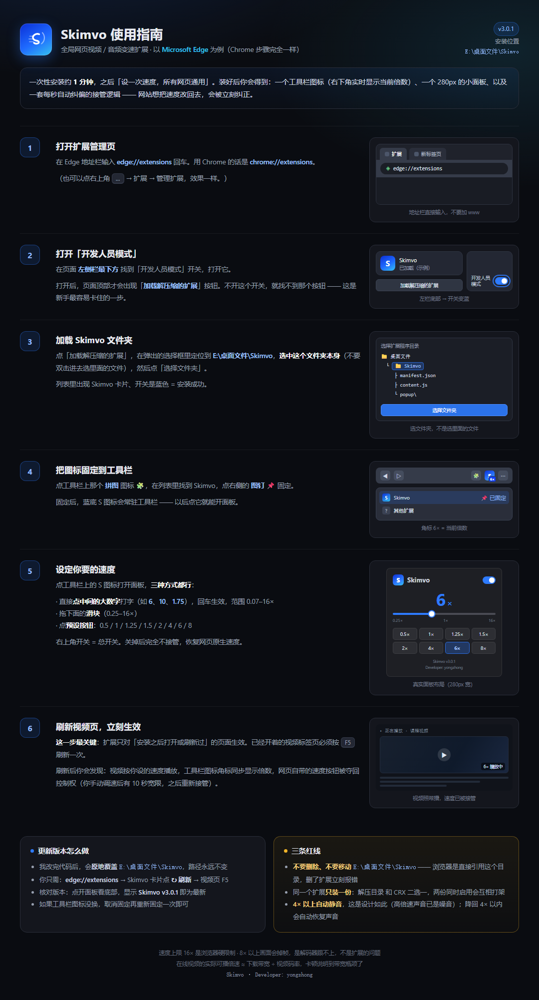

# Skimvo

> 一个速度，全站通用 —— 给所有网页视频设统一的播放倍速，设一次，永久生效。

浏览器扩展（Chrome / Edge 通用，Manifest V3）。**免费、不联网、零依赖**，加载文件夹即用。

## 下载

| 文件 | 说明 |
| --- | --- |
| [Skimvo-v3.0.1.zip](Skimvo-v3.0.1.zip) | 最新版，解压到固定目录后按下面的步骤加载 |
| [Releases](../../releases/latest) | 历史版本归档 |

> 本仓库只发布扩展安装包，不设源码仓库。

## 安装（Edge 为例，约 1 分钟）

1. 地址栏输入 `edge://extensions`（Chrome 是 `chrome://extensions`）
2. 打开「开发人员模式」
3. 点「加载解压缩的扩展」，选择解压出来的 `Skimvo` **文件夹本身**
4. 工具栏拼图图标 → 把 Skimvo 固定出来

> ⚠️ 解压后的文件夹**不能删、不能移动**——浏览器是直接引用这个路径的，移走扩展就失效了。
> 建议解压到固定位置（例如 `D:\Skimvo`），不要放桌面或下载目录。

## 功能

| 功能 | 说明 |
| --- | --- |
| 全局变速 | 0.07× – 16× 全区间，滑块 / 8 个预设挡位 / 手动输入三种入口 |
| 全站生效 | 所有网页的视频音频自动套用，新标签、刷新、换站点都保持 |
| 反倍速纠偏 | 播放器自行把速度改回去时自动拉回，另加每秒兜底巡检 |
| 工具栏角标 | 图标右下角实时显示当前倍速，暂停接管时显示 ⏸ |
| 高倍率静音 | 超过 4× 自动静音（刷画面不留噪音），降回 4× 内自动恢复 |
| 手动宽限 | 你在播放器里手动调速后 10 秒内不干预 |
| 跨设备同步 | 设置存浏览器账号，换设备自动带过去 |

## 使用

点工具栏上的 Skimvo 图标弹出面板：

- **中间的大数字可直接点击输入** —— 支持 `1.75`、`12` 这类精确值，回车生效，范围 0.07–16
- **滑块**粗调，**预设** 8 个常用挡位一键直达（0.5 / 1 / 1.25 / 1.5 / 2 / 4 / 6 / 8）
- 右上角**开关**暂停接管，恢复浏览器原速 1×

面板底部显示当前版本号，更新后可据此核对是否刷新成功。

## 系统要求

- Windows / macOS / Linux 上的 Chrome、Edge 或其它 Chromium 内核浏览器
- 无需安装任何运行库，不联网、不收集任何数据

## 已知限制

- **DRM 加密流媒体**（Netflix 等）无法接管，所有同类扩展的共同限制
- **在线视频的实际倍速受带宽限制**：播放消耗数据的速度超过下载速度时会反复缓冲，
  观感上「上不去」，这是网络物理瓶颈，不是扩展的问题
- **4× 以上声音**浏览器会压掉或变成噪音，故本扩展在 4× 以上直接静音
- **8× 以上可能掉帧**，解码器跟不上的正常现象，适合纯刷画面

## 许可

**个人非商业用途免费** —— 可免费在任意数量的自有设备上使用，可在个人之间转发原始安装包。

**商业用途需授权** —— 含企业内部使用、嵌入商业产品、对外提供服务，请联系 hongyongzhong2020@126.com。

**请勿修改后分发** —— 不得摘取代码用于其他项目，不得以自有作品名义重新发布。

详细条款见 [LICENSE](LICENSE)。

## 更新日志

### v3.0.1
- 更换 S 形 LOGO
- 面板预设调整为 0.5 / 1 / 1.25 / 1.5 / 2 / 4 / 6 / 8
- 面板圆角与配色统一为暗底 + 品牌蓝

### v3.0.0
- 更名 Skimvo（原名与商店已有扩展冲突）

### v2.3.0
- 4× 以上自动静音（刷课刷画面场景）
- 面板显示版本号与开发者署名

### v2.1.0
- 工具栏图标角标实时显示当前倍速

### v2.0.0
- 全新品牌标识与面板头部

### v1.3.0
- 支持手动输入精确倍速，区间放宽到 0.07×–16×

---

Developer: yongzhong · 问题与建议请提 [Issue](../../issues)
